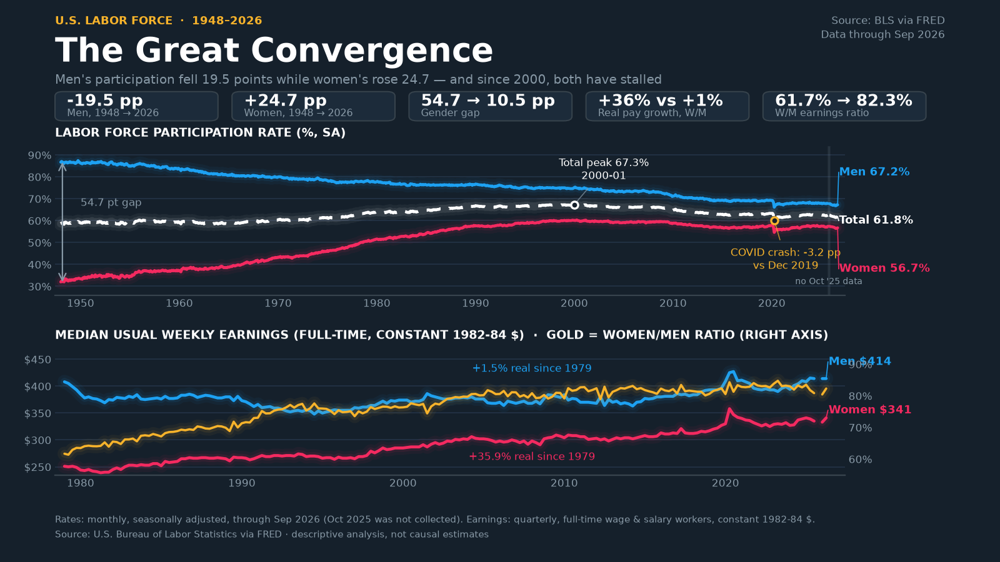

# U.S. Workforce Participation: The Great Convergence

Analysis and visualization of U.S. labor force participation and median weekly
earnings by gender, built from public Bureau of Labor Statistics (BLS) series
retrieved through [FRED](https://fred.stlouisfed.org/). The project turns 32
series (30 FRED + 2 BLS) into a reproducible written report, a machine-readable
statistics file, and three Twitter-ready visuals.



> _If the image above does not render, it has not been generated yet — run
> `pixi run viz` (see [Quick start](#quick-start))._

## The story in one paragraph

Men's labor force participation rate fell **19.5 points** (86.7% → 67.2%) over
the 1948–2026 span while women's rose **24.7 points** (32.0% → 56.7%), narrowing
the gender participation gap by **44.2 points** (54.7 pp → 10.5 pp). Women's
real median weekly earnings grew **+35.9%** since 1979 while men's were
essentially flat (**+1.5%**), lifting the women-to-men earnings ratio from
**61.7% to 82.3%**. Since 2000 both genders have stalled or drifted down
together. These are **descriptive associations, not causal estimates**.

All figures above are read from `analysis.compute_stats()` — the single source
of truth for every number that appears in the report and on the charts.

## Quick start

This project uses [pixi](https://pixi.sh/) for fully reproducible environments.
There are no system-level Python dependencies.

```powershell
# Install the environment (first run only; downloads conda packages)
pixi install

# 1. Download every FRED and BLS series into data/raw/ (cached for 30 days)
pixi run fetch

# 2. Compute statistics and write output/findings.md + output/summary.json
pixi run analyze

# 3. Build all three visuals into output/
pixi run viz
```

`pixi run fetch` is optional before `analyze`/`viz`: both fetch automatically
on first run. Use `--refresh` on any data-loading command to bypass the 30-day
cache and re-download from FRED:

```powershell
pixi run analyze --refresh
pixi run viz --refresh
```

### Requirements

- **pixi** — installs and pins everything else (`python>=3.11`, `pandas`,
  `requests`, `matplotlib`, `plotly`, `pillow`, `pytest`, `pytest-cov`, `ruff`).
- **ffmpeg** — bundled through pixi; required for the animated **MP4**. If it is
  unavailable the animation silently falls back to a GIF.
- **BLS API key (optional)** — The two BLS series are always fetched from the
  BLS Public Data API v2. Setting `BLS_API_KEY` is optional and only raises the
  rate limit; unauthenticated requests work but are throttled. You can obtain a
  free key from the [BLS Developer Portal](https://www.bls.gov/developers/).
  **Known defect:** the currently cataloged BLS IDs are mislabeled part-time
  employment levels, not weekly hours; see
  [docs/data.md](docs/data.md#bls-series-known-defect).
- **Platform support** — the pixi environment is currently declared for **Windows 64-bit (`win-64`) only** (`pixi.toml`). The macOS/Linux shell commands shown below are provided for convenience when setting `BLS_API_KEY`, but the full pipeline is only tested on Windows.

> **Tip:** Set `BLS_API_KEY` in your shell environment:
> - **macOS/Linux:** `export BLS_API_KEY=your_key_here`
> - **Windows (PowerShell):** `$env:BLS_API_KEY="your_key_here"`

The BLS data is fetched by `pixi run fetch` and `pixi run analyze` regardless of
whether a key is set; the key only improves rate limits.

## Commands

| Command | What it does |
| --- | --- |
| `pixi run fetch` | Download every FRED and BLS series into `data/raw/` (cached 30 days). |
| `pixi run analyze` | Regenerate `output/findings.md` + `output/summary.json`. |
| `pixi run viz` | Build all three visuals in `output/`. |
| `pixi run viz --static` | Only `output/twitter_hero.png` (1600×900). |
| `pixi run viz --animated` | Only `output/twitter_hero.mp4` (needs ffmpeg). |
| `pixi run viz --interactive` | Only `output/twitter_interactive.html`. |
| `pixi run test` | Run the full test suite. |
| `pixi run test-cov` | Run the suite with a coverage report. |
| `pixi run style` | `ruff format` + `ruff check --fix` — **run before committing**. |
| `pixi run fmt --check` | Formatting verification only. |
| `pixi run ruff check --no-fix` | Lint verification only. |

Any data-loading command accepts `--refresh`. See
[docs/outputs.md](docs/outputs.md) for the full CLI reference.

## Outputs

| File | Description |
| --- | --- |
| `output/findings.md` | The written findings report (markdown). |
| `output/summary.json` | Every computed statistic as strict JSON (`allow_nan=False`). |
| `output/twitter_hero.png` | Static 1600×900 dark-theme hero chart. |
| `output/twitter_hero.mp4` | Animated reveal (180 frames @ 15 fps ≈ 12 s). |
| `output/twitter_interactive.html` | Self-contained interactive Plotly page. |

`findings.md` and `summary.json` are regenerated by `pixi run analyze`; the
visuals by `pixi run viz`. The report, JSON, PNG, and MP4 are **committed
deliverables**. The currently committed versions predate the 32-series
expansion (they still report 25 series and omit the weekly-hours/shift-share
blocks); regenerate them only after the two known defects above are fixed.

The interactive HTML is by far the largest artifact (~21.6 MB, mostly the inlined
Plotly bundle). It is **not tracked**; run `pixi run viz --interactive` to
generate it locally. See
[docs/outputs.md](docs/outputs.md#artifact-size-policy) for the full policy.

## Project layout

```
.
├── series.py          # FRED/BLS catalog: series IDs, labels, units, PALETTE
├── data_common.py     # Shared cache-staleness and date helpers
├── fred_data.py       # FRED CSV + BLS API v2 client + local cache; FetchError
├── labor_data.py      # Assembles monthly / quarterly / hourly frames + coverage
├── analysis.py        # compute_stats() + findings renderer + CLI
├── labor_viz.py       # Static PNG, animated MP4/GIF, interactive HTML + CLI
├── data/raw/          # Cached FRED CSVs (committed)
├── data/raw/*.json    # Cached BLS series (committed; see known defect)
├── output/            # Generated report, JSON, and visuals (committed)
├── tests/             # pytest suite (see docs/development.md)
├── docs/              # This documentation set
├── pixi.toml          # Environment + task definitions
├── pytest.ini         # pytest configuration
├── CONTRIBUTING.md    # Contributor pointer (→ docs/development.md)
└── AGENTS.md          # Agent-oriented project brief
```

A full breakdown lives in [docs/architecture.md](docs/architecture.md).

## Data sources and caveats

- **Primary source:** BLS/CPS and BLS/CES series retrieved from FRED. The complete
  catalog (32 series: 30 FRED + 2 BLS) is documented in [docs/data.md](docs/data.md).
- **Secondary source:** two BLS series retrieved directly from the BLS Public
  Data API by `fred_data.fetch_bls_series()`. The `BLS_API_KEY` is optional. The
  current IDs are **mislabeled** (part-time employment levels, not weekly
  hours); see [docs/data.md#bls-series-known-defect](docs/data.md#bls-series-known-defect).
  Treat the weekly-hours block as invalid until the IDs and cache are fixed.
- **October 2025 is missing from the CPS series (and the CPI)** — no field work
during the 2025 federal government shutdown. The gap is retained
as `NaN` and annotated on the chart; it is **never interpolated**. (The
population and earnings-level series have a value for that month; see
[docs/data.md](docs/data.md#the-october-2025-gap).)
- **Participation rates are seasonally adjusted; the gender population levels
(`LNU...`) are not.** This is why implied and published rates differ in the
third decimal (documented in the report's consistency checks).
- **Earnings are quarterly (since 1979) and cover full-time wage and salary
workers only**, so they cannot explain monthly movements.
- **Correlation is not causation.** The earnings/participation alignment is a
  descriptive association; no identification strategy is used.
- **Two blocks are known-broken and must not be cited:** the BLS "weekly hours"
  series (mislabeled IDs) and the experimental shift-share decomposition (the
  between-group term is non-physical). See
  [docs/data.md](docs/data.md#bls-series-known-defect) and
  [docs/methodology.md](docs/methodology.md#shift-share-decomposition-calculate_shift_share).

See [docs/methodology.md](docs/methodology.md) for definitions and
[docs/data.md](docs/data.md) for the catalog and coverage model.

## Documentation

| Document | Contents |
| --- | --- |
| [docs/README.md](docs/README.md) | Documentation index. |
| [docs/architecture.md](docs/architecture.md) | Pipeline stages, modules, data flow, error handling. |
| [docs/data.md](docs/data.md) | FRED catalog, derived columns, coverage, cache format. |
| [docs/methodology.md](docs/methodology.md) | Statistical definitions and interpretation. |
| [docs/outputs.md](docs/outputs.md) | Report/JSON schema and visual specifications. |
| [docs/development.md](docs/development.md) | Setup, conventions, testing philosophy, defect register. |
| [docs/roadmap.md](docs/roadmap.md) | Future data sources and planned enhancements. |
| [docs/roadmap-original-notes.md](docs/roadmap-original-notes.md) | Archive: original roadmap working notes retained for provenance. |
| [CONTRIBUTING.md](CONTRIBUTING.md) | Short contributor pointer to the full guide. |
| [AGENTS.md](AGENTS.md) | Concise agent brief (commands, invariants, testing bar). |

## Testing

The suite follows a **high-bar testing standard**: tests pin exact mathematical
behavior, boundary conditions, and failure modes — not line coverage. Coverage
(99% target) is a byproduct, not the goal.

```powershell
pixi run test        # full suite
pixi run test-cov    # with coverage report
```

See [docs/development.md](docs/development.md) for the testing philosophy, the
offline fixtures, and the defect register.

## License and attribution

- No license file is currently declared for this repository; add one before
  distributing.
- All source data is public: U.S. Bureau of Labor Statistics series retrieved
  via the Federal Reserve Bank of St. Louis (FRED). Please credit "BLS via
  FRED" in any published derivative.
