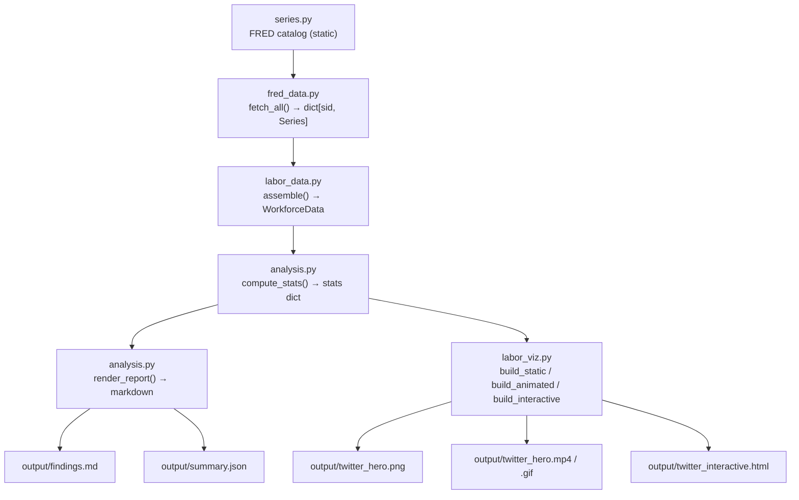

# Architecture

The project is a linear, five-stage data pipeline. Each stage has a single
responsibility and a narrow interface, which keeps the statistical math testable
in isolation from network I/O and rendering.

## Pipeline overview



```text
series.py ──▶ fred_data.py ──▶ labor_data.py ──▶ analysis.compute_stats()
                    │                                  │
                    ▼                                  ├──▶ render_report() ──▶ findings.md + summary.json
             data/raw/*.csv                            └──▶ labor_viz.build_*() ──▶ png / mp4 / html
```

## Modules

| Module | Responsibility | Key public surface |
|---|---|---|
| `series.py` | Static catalog of the 25 FRED series: IDs, labels, units, seasonality, gender/track tags, and the chart `PALETTE`. No I/O. | `SERIES`, `BY_SID`, `ALL_SIDS`, `PALETTE`, `SeriesSpec`, `sid()` |
| `fred_data.py` | Fetch FRED CSVs over HTTP, cache them verbatim under `data/raw/`, and parse them into named `pd.Series`. | `fetch_series()`, `fetch_all()`, `clear_cache()`, `FredFetchError` |
| `labor_data.py` | Join the cached series into three analysis-ready frames and add derived columns; build the per-series coverage report. | `build()`, `assemble()`, `WorkforceData` |
| `analysis.py` | Compute every headline statistic and render the findings report. Also the analysis CLI. | `compute_stats()`, `render_report()`, `col()`, `EmptySeriesError`, `main()` |
| `labor_viz.py` | Render the static hero PNG, the animated reveal, and the interactive HTML. Also the viz CLI. | `HeroFigure`, `build_static()`, `build_animated()`, `build_interactive()`, `main()` |

## Data flow

1. **Catalog → fetch.** `fred_data.fetch_all()` iterates `series.BY_SID` and
   calls `fetch_series()` for each ID. A series is served from the cache when
   the cached file is present and younger than `CACHE_MAX_AGE_DAYS` (30); it is
   otherwise downloaded from `https://fred.stlouisfed.org/graph/fredgraph.csv`
   and written back to `data/raw/<sid>.csv`.
2. **Fetch → assemble.** `labor_data.assemble()` receives the
   `dict[sid, Series]` mapping. `_frame()` joins the selected series into a
   single column-renamed, index-sorted frame per frequency (monthly, quarterly,
   hourly). `_add_derived_*()` layers computed columns on top.
3. **Assemble → stats.** `analysis.compute_stats()` reads the frames and returns
   one nested dictionary (`stats`) containing every number the report and the
   charts display.
4. **Stats → outputs.** `render_report()` turns `stats` into markdown;
   `main()` writes `findings.md` and `summary.json`. `labor_viz.build_*()`
   consume the *same* `stats` dict plus the frames to draw the visuals.

### Single source of truth

`analysis.compute_stats()` is the **only** place headline numbers are derived.
Both the report renderer and the chart builders read from its output; neither
recomputes a statistic. When adding a figure, add it to `compute_stats()` and
pass it through — **never hardcode a number into a visualization.** This
invariant is pinned by the test suite.

## Error-handling model

The pipeline distinguishes three failure classes:

| Failure | Raised as | Behaviour |
|---|---|---|
| Unknown series ID, HTTP non-200, or unparseable CSV | `fred_data.FredFetchError` | Raised to the caller; the CLI exits non-zero. |
| Network-level error (DNS, timeout, reset) | `requests.RequestException` | Propagates **unwrapped** from `fred_data` (documented contract). |
| Degenerate statistics input (empty / all-NaN series, empty join) | `analysis.EmptySeriesError` | Raised deliberately instead of emitting `NaN` or an empty mapping. |

Design notes:

- **Corrupt cache is self-healing.** If a cached file exists but fails to parse,
  `fetch_series()` discards it and re-downloads (defect **D2**).
- **Zero denominators become `NaN`.** `labor_data._safe_ratio()` masks
  divide-by-zero results so `inf`/`NaN` never leak into stats or JSON
  (defect **D5**).
- **EmptySeriesError is a tripwire.** A statistics helper that receives a series
  with no observed values raises rather than letting a downstream renderer
  index into an empty mapping much later (the failure mode of defects **D6–D10**).
- **CLI failure UX is uniform.** Both `analysis.main()` and `labor_viz.main()`
  catch `(FredFetchError, requests.RequestException)` and terminate with a
  non-zero `SystemExit` (**D11**); `analysis.main()` calls
  `sys.exit("Execution Error: …")` and `labor_viz.main()` prints the message and
  raises `SystemExit(1)`.

The defect register with full dispositions lives in
[../AGENTS.md](../AGENTS.md#defect-register--disposition) and is summarised in
[development.md](development.md#defect-register).

## Caching model

- **Location:** `data/raw/<sid>.csv`, written verbatim as returned by FRED.
- **Freshness:** a hit is used when its age is **≤** `CACHE_MAX_AGE_DAYS` (30).
  Staleness is strictly *older than* the budget; exactly 30 days is fresh.
- **Refresh:** `refresh=True` (CLI `--refresh`) forces a download regardless of
  age.
- **Timeout:** every request uses `REQUEST_TIMEOUT_SECONDS` (30).
- **Clearing:** `fred_data.clear_cache()` deletes `*.csv` only, leaving other
  files untouched.

The cached CSVs are **committed** so analyses are reproducible offline and FRED
is not re-hit on every run.

## CLI entry points

Both modules expose a `main()` guarded by `if __name__ == "__main__":`, and each
is wired to a pixi task in `pixi.toml`:

- `analysis.py` → `pixi run analyze` (flags: `--refresh`, `--outdir`).
- `labor_viz.py` → `pixi run viz` (flags: `--static`, `--animated`,
  `--interactive`, `--all`, `--refresh`, `--outdir`).

See [outputs.md](outputs.md) for the full CLI reference and file schemas.
